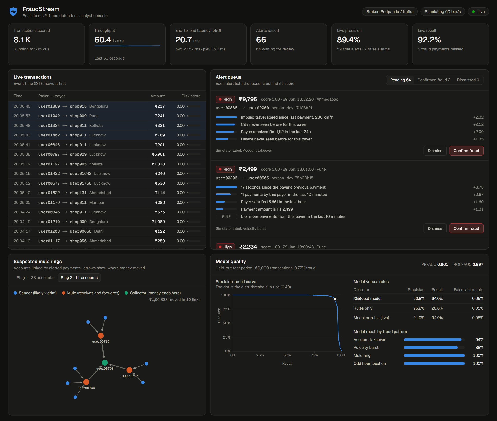
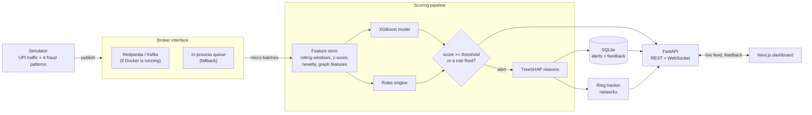
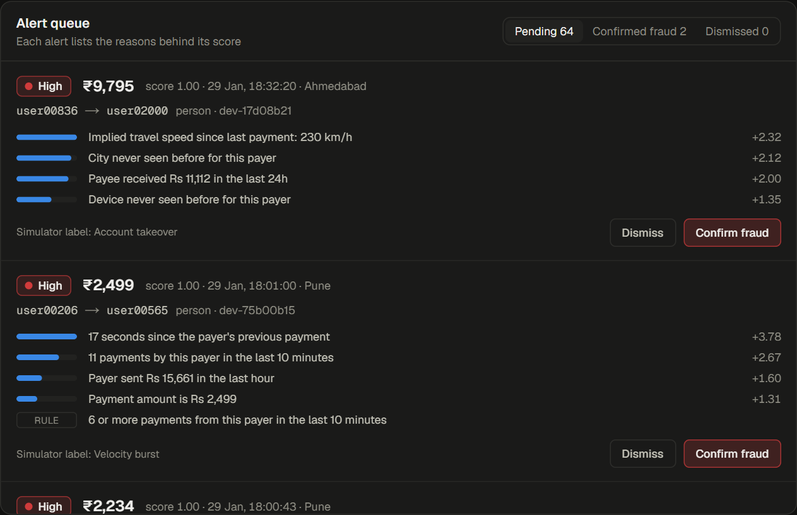
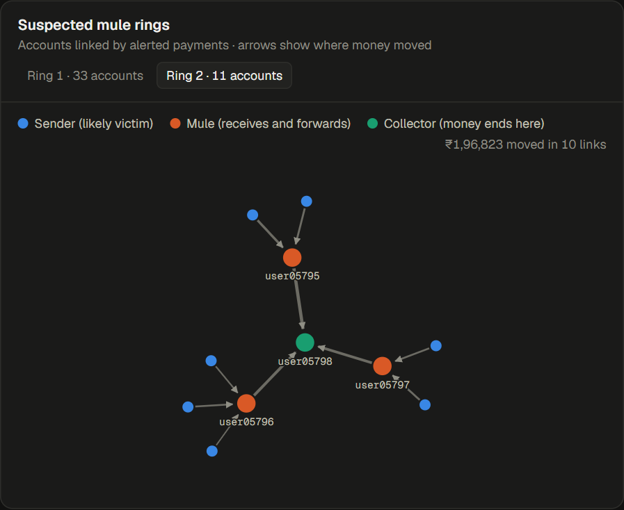
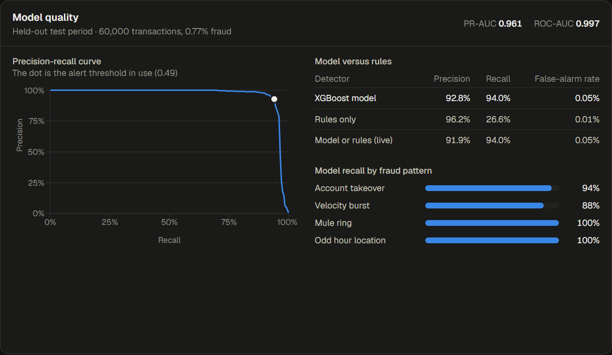

# FraudStream

A real-time fraud detection pipeline for UPI-style payments. A simulator
produces transactions with four injected fraud patterns; a streaming pipeline
turns each one into features, scores it with XGBoost and a rules engine, explains
every alert with SHAP, and pushes results to a live analyst dashboard.

Everything runs on one laptop CPU with free tools. Docker is optional.



## Measured results

All numbers are reproducible with the commands in [Reproducing the numbers](#reproducing-the-numbers).
The data is simulated, so read the quality numbers as "the pipeline works as
designed", not as a claim about real-world fraud.

**Model quality** on a held-out test period (the last 15% of the timeline,
60,000 transactions, 0.77% fraud):

| Detector | Precision | Recall | False-alarm rate |
|---|---|---|---|
| XGBoost model | 92.8% | 94.0% | 0.05% |
| Rules only | 96.2% | 26.6% | 0.01% |
| Model or rules (what runs live) | 91.9% | 94.0% | 0.05% |

PR-AUC 0.961. On a live stream generated with a different random seed
(60,000 events the model never saw): 92.3% precision, 95.0% recall.

**Speed** (Intel Core Ultra 5 225H, 16 GB, Windows 11, Python 3.14, median of 3 runs):

| Path | Max throughput | Latency at 500 txn/s (p50 / p95 / p99) |
|---|---|---|
| In-process queue, one model call per transaction | 2,070 txn/s | 0.5 / 0.8 / 1.6 ms |
| In-process queue, micro-batched | 20,600 txn/s | 0.5 / 0.7 / 1.6 ms |
| Redpanda (Kafka protocol), micro-batched | 6,270 txn/s | 18.1 / 22.3 / 24.1 ms |

Latency is end to end: publish, broker, features, model, rules, and for alerts
SHAP plus the SQLite write. Throughput depends on the machine's state: runs
taken while the laptop was busy were about 2.5 times lower, with the same 10x
gain from micro-batching.

## Quick start

Needs Python 3.11+ and Node.js 20+. Docker Desktop is optional.

```bat
start.bat
```

The first run creates a virtual environment, installs packages, trains the model
and installs the frontend (a few minutes). After that it starts in seconds and
opens the dashboard at http://localhost:3100.

- If Docker is running, the script starts Redpanda and the pipeline uses it.
- If not, it uses an in-process queue behind the same interface. Nothing else changes.

Options: `start.bat -NoDocker`, `start.bat -Tps 60`, `start.bat -ApiPort 8001 -WebPort 3200`.

To stop: close the two PowerShell windows it opened. `docker compose down` stops Redpanda.

## Architecture



The producer and the scorer only talk through the broker, so they could run as
separate services without code changes. The scoring pipeline is a plain Python
class with no I/O, which is why the API, the benchmark and the tests all share it.

## What it detects

| Fraud pattern | How it is simulated | What catches it |
|---|---|---|
| Account takeover | New device, distant city, several large payments to drop accounts | Device and city novelty, travel speed, amount z-score |
| Velocity burst | Many small payments seconds apart from the victim's own device | Rolling counts over 10 minutes and 1 hour |
| Mule ring | Victims pay new accounts that forward the money to a collector | Graph features: payee fan-in, pass-through ratio, time since money was received |
| Odd hour and location | One large payment at 1 to 4 AM from another city | Hour, night flag, city novelty, amount z-score |

Legitimate users also travel, change phones, make big purchases and pay new
accounts, so no single feature gives the answer away.

## How it works

1. **Features** ([features.py](backend/fraudstream/features.py)). Each account
   keeps a small state: the last 24 hours of payments, running mean and variance
   of log-amount, and the devices, cities and payees seen so far. Each
   transaction becomes 23 features, computed *before* the state is updated so a
   feature never includes the payment it describes. Training replays history
   through the same class, so training and serving cannot drift apart.
2. **Model** ([train.py](backend/fraudstream/train.py)). XGBoost, trained with a
   time-based split and `scale_pos_weight` for the 0.77% fraud rate. The alert
   threshold is the lowest score that keeps validation precision at 90% or more.
3. **Rules** ([rules.py](backend/fraudstream/rules.py)). Five readable rules
   (impossible travel, velocity, night-time new device, mule fan-in, rapid
   pass-through) run next to the model.
4. **Explanations** ([model.py](backend/fraudstream/model.py)). Each alert gets
   its top SHAP contributions as plain sentences, such as "Device never seen
   before for this payer".
5. **Serving** ([api.py](backend/fraudstream/api.py)). FastAPI pushes
   transactions, alerts and statistics over a WebSocket; alerts and analyst
   decisions are stored in SQLite.

| Alert queue with reasons | Suspected mule ring |
|---|---|
|  |  |



## Project layout

```
backend/
  fraudstream/
    config.py      constants, paths, feature list
    schema.py      Transaction dataclass
    simulator.py   traffic generator and fraud episodes
    features.py    streaming feature store
    rules.py       rules engine
    model.py       scoring and SHAP explanations
    train.py       training and evaluation
    broker.py      Kafka/Redpanda and in-process brokers
    storage.py     SQLite alert store
    graph.py       mule-ring detection
    pipeline.py    features + model + rules + alerts
    api.py         FastAPI app and WebSocket
    benchmark.py   throughput and latency measurement
  tests/           29 tests
frontend/
  app/             page shell and design tokens
  components/      dashboard panels
  lib/             types, API helpers, the data hook
docs/
  STUDY_GUIDE.md   concepts, decisions, interview Q&A, file walkthrough
  benchmark.json   raw benchmark output
start.bat          one-command start
```

## Reproducing the numbers

```powershell
cd backend
..\.venv\Scripts\python -m pytest                              # 29 tests
..\.venv\Scripts\python -m fraudstream.train                   # model quality -> models\metrics.json
..\.venv\Scripts\python -m fraudstream.benchmark               # in-process, micro-batched
..\.venv\Scripts\python -m fraudstream.benchmark --no-batching # in-process, one call per txn
..\.venv\Scripts\python -m fraudstream.benchmark --broker kafka  # through Redpanda (docker compose up -d first)
```

The simulator uses fixed seeds, so the model-quality numbers come out the same
on every machine. Speed numbers depend on the CPU.

## Design decisions

- **Event time, not wall-clock time, drives every feature.** That is what lets
  two weeks of history be generated in seconds for training and replayed live.
- **Adaptive micro-batching.** Profiling showed 85% of scoring time was fixed
  per-call overhead in XGBoost. The scorer now takes whatever is already
  waiting and scores it in one call: batch size 1 when idle, larger under load.
- **XGBoost's built-in TreeSHAP** rather than the `shap` package: same
  algorithm, no extra dependency, and it passes the additivity test (base value
  plus contributions equals the model output).
- **Warm-up by replay.** The API replays 340,000 simulated transactions before
  scoring so account state is as mature as it was in the test period. With a
  shorter warm-up live precision fell to about 83%.
- **SQLite for alerts.** Under 1% of traffic becomes an alert, so a zero-setup
  database is enough.

## Limitations

- The data is simulated, and the fraud patterns were written by the same person
  who built the detector. Real fraud is messier and changes over time.
- Feature state lives in one process's memory. A production system would use
  Redis or a stream processor so state survives restarts and scales out.
- Events are assumed to arrive in order; late events are not handled.
- Analyst feedback is stored but not yet used for retraining.
- The API has no authentication. It is a local demo.

More detail, including interview questions, is in [docs/STUDY_GUIDE.md](docs/STUDY_GUIDE.md).

## Resume bullets

- Built a real-time UPI fraud detection pipeline (Python, Redpanda/Kafka,
  FastAPI, XGBoost, Next.js) that scores 6,200 transactions/sec end to end
  through Redpanda at 18 ms median and 24 ms p99 latency on a single laptop CPU.
- Engineered 23 streaming features (rolling velocity windows, amount z-score,
  device and location novelty, graph features for mule rings) with one shared
  training/serving code path; the model reached 92.8% precision and 94.0%
  recall (PR-AUC 0.96) on a time-held-out test set of simulated traffic with
  0.77% fraud, against 26.6% recall for rules alone.
- Profiled the scorer and added adaptive micro-batching for a 10x throughput
  gain (2,070 to 20,600 transactions/sec) with median latency unchanged at
  0.5 ms; added per-alert SHAP explanations, a live analyst dashboard with a
  mule-ring graph, and 29 automated tests.
